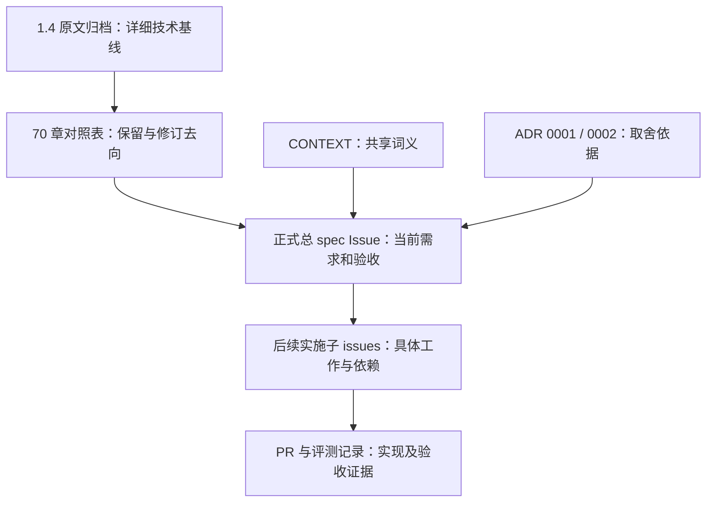

# Bridge Coup 2.0 文档入口

**从[正式总 spec Issue](https://github.com/absurdwall/bridge-coup/issues/33)开始。** 它定义当前产品范围、需求、测试决策和发布门槛，并作为后续实施 tickets 的父 spec。

## 各份材料负责什么

| 材料 | 位置 | 用途与维护规则 |
| --- | --- | --- |
| 当前正式 spec | [GitHub Issue](https://github.com/absurdwall/bridge-coup/issues/33) | 决定现在要做什么、怎样验收；后续修订更新此 Issue，不另存一份可独立修改的本地正文。 |
| 原始架构长文 | [source-spec-1.4.md](source-spec-1.4.md) | 用户提供的 1.4 原文，逐字节归档；保留详细技术约束和设计来由，不修改原稿来冒充新版本。 |
| 章节去向与修订表 | [source-map.md](source-map.md) | 原稿 70 章逐一对应当前 spec 条款，标明保留、澄清、修订、延后或替代；它是导航，不是第二份需求正文。 |
| 领域术语 | [CONTEXT.md](../../CONTEXT.md) | 定义决策控制者、连续辅导、计分背景、正式战略目标等共享语言；保持为术语表。 |
| 产品范围与发布取舍 | [ADR 0001](../adr/0001-bridge-2-continuous-coaching-and-content-scope.md) | 解释为什么允许人工录入其他座位、首发小型内容集，以及为何基本质量仍是发布硬门槛。 |
| 目标与评测裁判取舍 | [ADR 0002](../adr/0002-strategic-objectives-and-independent-evaluation.md) | 解释目标与计算指标的区别，以及专家来源加人工裁定的依据。 |
| 后续实施 tickets | 当前 spec 的 GitHub 子 issues | 拆成可执行的纵向工作，引用需求／测试／里程碑和依赖；本次 to-spec 尚未创建这些 tickets。 |
| 实现与验收证据 | 后续 ticket 关联 PR／评测记录 | 证明已实现哪些条款、验证了什么、还缺什么；发布 spec 本身不构成实现或发布完成。 |

## 阅读顺序

1. 看正式 Issue 的 Solution、R19 发布门槛和 M0–M7 里程碑，先理解交付范围。
2. 按承担的工作看 R01–R22 需求与 T01–T13 测试决策。用户已确认：以 App 请求到 Expert 结果／连续牌局为主要测试入口，另保留数学、真实 runtime 和打包 App 验收。
3. 从章节对照表进入 1.4 中相关章节，获取更细的语义和示例。不要只读简短 ticket 就丢掉被引用的架构约束。
4. 遇到词义或重要取舍，分别查 CONTEXT 和 ADR；具体实施则读对应 ticket、依赖及 PR。

## 权威关系和更改方式

正式 Issue 是当前需求入口，并明确引用 1.4 作为详细技术基线。Issue 的六项修订优先于原文相应表述：连续辅导、中途求助、目标语义、基础 CCBA、评测／内容规模以及最低发布质量。其余被引用的技术约束继续适用。原文的 frozen、版本状态和内部 authority map 不能覆盖后来的明确决定。

CONTEXT 管词义，ADR 管为什么这样选择；它们不是另一份完整 spec。未来若真的改变产品承诺或职责边界，应同步修订 Issue 及受影响的 ADR／术语／章节映射，不能让 ticket 或代码默默改变上层约束。普通文件名、类型形态和传输细节在既定职责内由实现决定。

## 本次发布状态

本次只发布总 spec、保存原文并建立导航／追溯关系。尚未创建实施 tickets，尚未实现 2.0，也未声称通过发布验收。`ready-for-agent` 表示规格可以指导后续有边界的实施工作；不代表允许把整个大工程当成一张实现 ticket，也不代表任何里程碑已经完成。

1.4 原文有 3,571 行、168,847 字节，SHA-256 为 `a9027db6cdfd10bb19603d896d3c8cb34f04322b1d18f749a45bfcc9eebdc947`。归档后，其他协作者不需要访问最初的 Downloads 文件。完整性和逐章映射见章节对照表。
